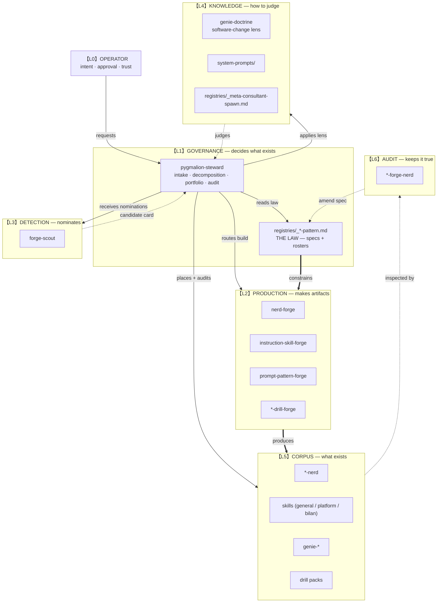

# Organization Chart

The canonical map of the Entity corpus. The Steward owns this chart; every new
Entity is placed on it before it is built.

## The chart



## The same chart, for the terminal

```
【L0】 OPERATOR
        │  intent, approval, trust
        ▼
【L1】 GOVERNANCE ────────────── pygmalion-steward
        │                      registries/_*-pattern.md  (the law)
        │
        ├──▶ 【L2】 PRODUCTION ── nerd-forge · instruction-skill-forge
        │                        prompt-pattern-forge · *-drill-forge
        │                              ║ produces (constrained by the law)
        ├──▶ 【L3】 DETECTION ─── forge-scout  ──nominates──▶ back to L1
        │
        ├──▶ 【L4】 KNOWLEDGE ─── genie-doctrine · system-prompts
        │                        _meta-consultant-spawn  ──judges──▶ L1
        │
        └──▶ 【L5】 CORPUS ────── *-nerd · genie-* · skills · drill packs
                                       │
【L6】 AUDIT ──────────────────────────┘  *-forge-nerd  ──amends──▶ L1 registry
```

## Layers and authority

| Layer | Role | Members | May | May not |
|---|---|---|---|---|
| **L0 Operator** | intent | you | request, approve, reject | — |
| **L1 Governance** | decides | `pygmalion-steward`, registries | intake, decompose, route, register, deprecate | build Family anatomies it does not own |
| **L2 Production** | makes | `nerd-forge`, `instruction-skill-forge`, `prompt-pattern-forge`, `*-drill-forge` | produce artifacts to spec | decide *whether* an artifact is needed |
| **L3 Detection** | nominates | `forge-scout` | flag opportunities | build |
| **L4 Knowledge** | judges | `genie-doctrine`, `system-prompts/`, `_meta-consultant-spawn` | supply lenses and patterns | produce corpus Entities |
| **L5 Corpus** | exists | nerds, genies, skills, drill packs | answer, mine, drill | govern themselves |
| **L6 Audit** | keeps true | `*-forge-nerd` | audit a Forge's corpus, amend its spec | forge another meta level |

## Where a new Entity attaches

Place the Entity on the chart **before** building it. This is the routing half of
the intake card.

| Family | Layer | Reports to | Producer | Registry |
|---|---|---|---|---|
| `steward` | L1 | Operator | steward (direct) | README + MANIFEST |
| `doctrine` | L4 | Steward (consumed) | steward (direct) | README + MANIFEST |
| `forge` | L2 | Steward | steward + registry spec | `_forge-pattern.md` |
| `forge-nerd` | L6 | its Forge | steward (direct) + `_forge-pattern.md` | `_forge-pattern.md` |
| `scout` | L3 | Steward | steward (direct) | `_tech-nerd-pattern.md` |
| `nerd` | L5 | Operator | `nerd-forge` | `_tech-nerd-pattern.md` |
| `genie` | L5 | Operator | steward (direct) | `skills/genies/README.md` |
| `skill` | L5 | Operator | `instruction-skill-forge` or steward | README + MANIFEST |
| `drill-pack` | L5 | its Forge | `*-drill-forge` | producer's `examples/` |
| `prompt` | L5 | Operator | Operator | README |
| `system-prompt` | L4 | Operator | Operator | README |

## Reporting lines, stated plainly

- **The Operator** sets intent. Nothing is created without a restated request.
- **The Steward** decides. It is the only Entity allowed to say "we do not need
  this" and the only one that registers new Entities.
- **Producers** execute a decision. A Forge that starts deciding *whether* to exist
  has overstepped into governance — that is `forge-scout`'s job.
- **Scouts** nominate. Their cards go to the Steward, never directly to a Forge.
- **Lenses** inform. A Doctrine has no authority over inventory; it changes how
  decisions are judged, not which Entities exist.
- **Auditors** amend specs. A Forge-nerd reports on its Forge's corpus and may
  propose registry amendments, which the Steward applies.

## Escalation and stop signs

| Situation | Route |
|---|---|
| "Should we build X?" | Operator → Steward (intake card) |
| "I keep doing X by hand" | Operator → Steward; Steward may call `forge-scout` |
| "Turn this instruction into a skill" | Operator → `instruction-skill-forge`, which may consult the Steward |
| "Make a nerd for X" | Operator → Steward → `nerd-forge` |
| "The nerds are drifting" | Steward → `--drift` sweep → per-nerd re-ground |
| "Two skills overlap" | Steward → Duplicate decision → merge or sharpen |
| "We need a forge-forge" | **Stop.** Terminal climb; fix the spec below instead |
| "We need a nerd-forge-nerd-nerd" | **Stop.** `*-forge-nerd` is terminal |

## Keeping the chart true

The chart is a living document with the same drift law as everything else.

- Every intake card names a **layer** and a **reports-to**.
- Every new Family adds a row to *Where a new Entity attaches*.
- Every retirement removes the Entity but leaves the row (marked retired).
- The audit does not check this chart — so the Steward reviews it whenever a
  Family is added, and at the monthly audit.
